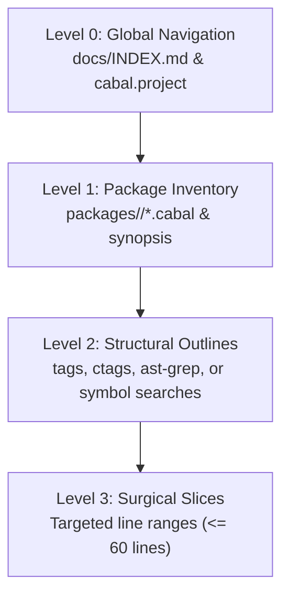

# Tengri Newbie Quickstart & Token-Conservation Guide

**Status:** CANONICAL ONBOARDING GUIDE · Cellarius Standard  
**Parent Strategy:** [`docs/notes/DOC_STRATEGY.md`](notes/DOC_STRATEGY.md)  
**Corpus Inventory:** [`docs/INDEX.md`](INDEX.md)  
**Tutorial:** [`docs/TUTORIAL.md`](TUTORIAL.md)  
**Maintainer Guide:** [`docs/MAINTAINER_GUIDE.md`](MAINTAINER_GUIDE.md)  
**Verification:** `./bin/tengri-verify`

---

## 1. Core Mental Model: Why Tengri Exists

Traditional GHC scripting tools (`ghc -e`, `runghc`, standard `ghci`) operate under a "cold batch" assumption: each invocation launches a new OS process, reconstructs the GHC state machine, parses the global package database, initializes the RTS, and compiles expressions from scratch. This introduces a 1.0–2.5 second penalty per evaluation.

Furthermore, standard GHCi bypasses source plugins during interactive prompt entry because statements are parsed as `GhciLStmt GhcPs` without instantiating a module summary (`ModSummary`).

```
[Standard GHCi REPL]
  Prompt Entry: "REC { a = 1 }"
       │
       ▼
  hscParseStmt (No ModSummary instantiated)
       │
       ▼
  [SKIPS parsedResultAction source plugins!]
       │
       ▼
  ERROR: "Not in scope: data constructor ‘REC’"
```

**Tengri flips this paradigm:**
- A long-running daemon (`tengri-savdag`) holds an initialized GHC runtime environment in memory.
- In-memory evaluation sessions (`tengri-ulgen`) wrap bare prompt inputs into synthetic compilation units, attaching mock `ModSummary` buffers (`ms_hspp_buf`).
- Source plugins (`Polytropos.Plugin`) execute normally, desugaring custom syntax before typechecking.
- Sub-millisecond evaluation latency is achieved across POSIX shell pipes and interactive REPL sessions.

---

## 2. The Progressive Disclosure Funnel

To protect context tokens and prevent attention degradation when working on Tengri, **never read or dump entire multi-thousand-line modules**. Always navigate using the 4-tier progressive disclosure funnel:



### Level 0: Global Navigation
Examine [`docs/INDEX.md`](INDEX.md) and [tengri.dhall](../tengri.dhall) to locate the relevant subsystem before inspecting files.

### Level 1: Package Topology
Locate the specific package under `packages/`:
- `packages/tengri-savdag/`: Unix domain socket daemon, supervisor, and process management.
- `packages/tengri-ulgen/`: Resident `GhcMonad` worker, mock `ModSummary` builder, and plugin runner.
- `packages/tengri-sulde/`: Precompiled algebraic prelude.
- `packages/tengri-lus/`: Stream pipes, regex conduits, and aggregators.
- `packages/tengri-darkhan/`: Abductive spine synthesis and arity bridge synthesis.
- `packages/tengri-toli/`: Shamanic mirror (type reflection, shell completion, Core inspection).
- `packages/tengri-zsh-preexec/`: Intercept hooks for Zsh.
- `packages/tengri/`: User-facing CLI binary.

### Level 2: Tag Navigation & Ast-Grep
Use `tags` or ripgrep to locate specific type signatures and functions without loading whole files:
```bash
# Locate function definition in tengri-ulgen
rg "mkMockModSummary" packages/tengri-ulgen/
```

### Level 3: Surgical Inspection
Read only the relevant function block using line ranges:
```bash
# Inspect only lines 20-60 of MockSummary.hs
```

---

## 3. Mongolian Celestial Taxonomy Reference

| Package | Etymology & Meaning | Core Role |
|:---|:---|:---|
| `tengri` | *Möngke Tengri* (The Eternal Blue Sky) | Unified CLI frontend & interactive REPL |
| `tengri-savdag` | *Savdag* (Earth/Place Master Spirits) | Resident Unix domain socket daemon |
| `tengri-ulgen` | *Ülgen* (Creator of Speech & Mind) | In-memory `GhcMonad` evaluator & plugin driver |
| `tengri-sulde` | *Sülde* (Celestial Vital Soul & Banner) | Algebraic prelude (`gongju`, `polytropos`) |
| `tengri-lus` | *Lus* (Water Spirits of Deep Conduits) | Stream pipelines and conduit transformers |
| `tengri-darkhan` | *Darkhan* (Sacred Heavenly Smith) | Abductive spine and arity bridge articulation |
| `tengri-toli` | *Toli* (Shamanic Bronze Mirror) | Inferred type reflection & GHC Core lens |
| `tengri-zsh-preexec` | Shamanic Boundary Gate | Zsh prompt interception hook |

---

## 4. Common Gotchas & Architectural Invariants

### Gotcha 1: Static vs Dynamic Linking of GHC API
- **Invariant:** When building packages that depend directly on the `ghc` package (`tengri-ulgen`, `tengri-savdag`), linking the executable against the static GHC archive (`libHSghc-*.a`) requires significant linking time (60–120s with GNU `ld.bfd`).
- **Remedy:** Do not interrupt the linker; during development, verify typecheck via `cabal build --ghc-options="-fno-code"` or `cabal check` for instant feedback.

### Gotcha 2: Daemon State Isolation
- **Invariant:** `tengri-savdag` maintains an active session worker (`UlgenWorker`). State modifications (e.g. `let x = 1`) persist across prompt evaluations within the same session.
- **Remedy:** Use `tengri session reset` or restart the daemon (`tengri daemon restart`) if the interactive environment enters a polluted or divergent state.

### Gotcha 3: The Mock `ModSummary` Buffer
- **Invariant:** In `tengri-ulgen`, `mkMockModSummary` attaches an in-memory `StringBuffer` (`ms_hspp_buf`) so `hscParse` never attempts to read from the filesystem.
- **Rule:** Never point `ms_hspp_buf` to `Nothing` when parsing synthetic snippets, otherwise GHC will attempt to stat and read dummy file paths on disk.

---

## 5. Development & Verification Workflow

Always run verification before committing changes:

```bash
# Run unit tests for a single package
cabal test tengri-ulgen

# Validate package manifest for Hackage compliance
cd packages/tengri-ulgen && cabal check

# Run full repository verification suite
./bin/tengri-verify
```
