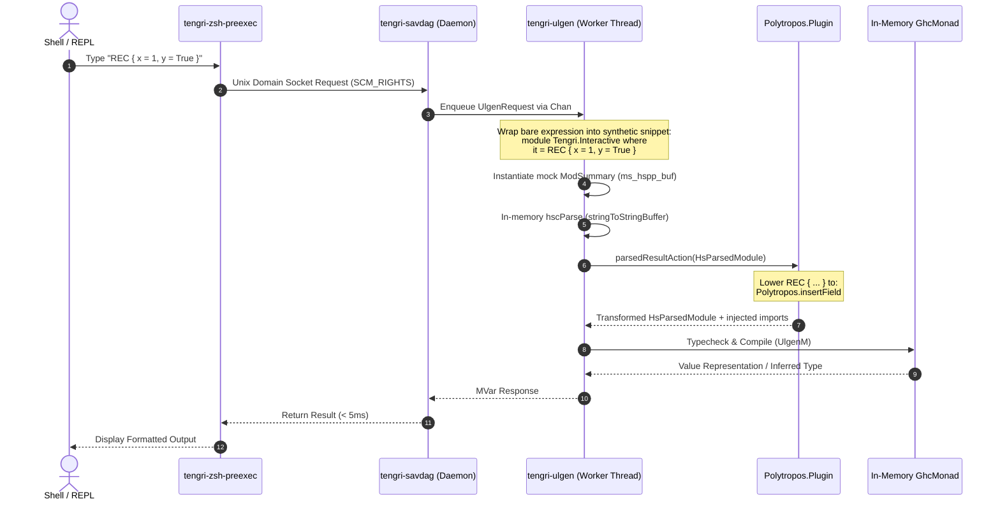

# Getting Started with Tengri: High-Throughput Interactive Haskell & Warm REPL Architecture

**Status:** CANONICAL TUTORIAL · Cellarius Standard  
**Parent Strategy:** [`docs/notes/DOC_STRATEGY.md`](notes/DOC_STRATEGY.md)  
**Corpus Inventory:** [`docs/INDEX.md`](INDEX.md)  
**Design Monograph:** [`docs/notes/TENGRI_DESIGN.md`](notes/TENGRI_DESIGN.md)  
**Verification:** `./bin/tengri-verify`

---

## 1. Executive Summary: The Latency Bottleneck in Shell Haskell

Haskell's expressive type system, row polymorphism, and algebraic data structures make it an ideal language for exploratory data processing, systems plumbing, and rapid prototyping. However, historically, using Haskell interactively within POSIX shell environments (`bash`, `zsh`) has suffered from a debilitating latency tax:

```
[Traditional GHC/GHCi Cold Invocation]
  $ ghc -e 'putStrLn "hello"'
  ├── Process Fork & Exec: ~15ms
  ├── RTS Initialization: ~20ms
  ├── Dynamic Linker & Package DB Traversal: ~350-800ms
  ├── Frontend Lexing, Parsing, Renaming: ~150ms
  └── Typechecking & Core Generation: ~250ms
  ─────────────────────────────────────────────────────────────
  TOTAL LATENCY: 800ms – 1,500ms (Unusable for Interactive Shells)
```

Furthermore, standard GHCi suffers from a critical architectural limitation: **interactive expressions do not run GHC source plugins**. Statements entered at the prompt are routed directly through `hscParseStmt` to `LHsExpr GhcPs`, bypassing the compilation pipeline's `ModSummary` structure. Consequently, advanced syntactic extensions—such as `Polytropos.Plugin`'s desugaring of row-polymorphic records (`REC { a = 1, b = "two" }`)—fail with:
```haskell
<interactive>:1:1: error: Not in scope: data constructor ‘REC’
```

**Tengri** eliminates both problems:
1. **Zero Cold-Start Overhead:** A warm, resident background daemon (`tengri-savdag`) holds initialized GHC runtime state, compiled package databases, and preloaded module environments in memory.
2. **First-Class Interactive Source Plugins:** Via `tengri-ulgen`, prompt expressions are wrapped into synthetic in-memory compilation units backed by mock `ModSummary` structures (`ms_hspp_buf`). Full source plugin passes (`parsedResultAction`) execute seamlessly, lowering syntactic sugar before typechecking and evaluation.
3. **Sub-Millisecond Shell Interception:** High-performance Zsh preexec integration (`tengri-zsh-preexec`) intercepts Haskell expressions in shell pipelines and delegates them over Unix domain sockets with zero disk I/O.

---

## 2. The Celestial Constellation: Mongolian Mythological Taxonomy

Tengri takes its name and structural taxonomy from classical Turko-Mongol celestial mythology (*Tengrism*):

| Package | Mythological Archetype | Engineering Responsibility |
|:---|:---|:---|
| **`tengri`** | *Möngke Tengri* (Мөнх Тэнгэр) — The Eternal Blue Sky, supreme cosmic canopy governing all phenomena | Unified CLI frontend, shell launcher, and interactive REPL entry point. |
| **`tengri-savdag`** | *Savdag* (Савдаг) — The master spirits of local ground and place | Warm background GHC daemon process supervising compilation state and IPC sockets. |
| **`tengri-ulgen`** | *Ülgen* (Үлгэн) — Celestial creator of speech, intellect, thought, and sacred fire | Resident `GhcMonad` evaluator thread executing in-memory mock `ModSummary` source plugin pipelines. |
| **`tengri-sulde`** | *Sülde* (Сүлд) — The vital soul and celestial destiny residing in the warrior's spearhead | Precompiled algebraic prelude re-exporting core combinators (`gongju`, `polytropos`). |
| **`tengri-lus`** | *Lus* (Луус) — The water spirits, masters of underground conduits and currents | Stream channels, conduits, lazy I/O evacuation, and regex aggregation pipelines. |
| **`tengri-darkhan`** | *Darkhan* (Дархан) — The sacred master smith endowed by heaven to forge iron and steel | Abductive spine synthesis and arity bridge articulation powered by `gargamelle` and `gongju`. |
| **`tengri-toli`** | *Toli* (Толь) — The shamanic bronze mirror reflecting invisible spiritual essences | Multi-shell completion, inline type reflection mirror, and GHC Core AST lens. |
| **`tengri-zsh-preexec`** | Boundary Shaman | C-level and binary preexec hook intercepting terminal inputs before standard execution. |

---

## 3. Architecture: Resident `GhcMonad` & Mock `ModSummary`

The following diagram illustrates how an interactive expression with custom syntactic sugar flows through Tengri without touching disk or restarting GHC:



---

## 4. Practical Hands-On Walkthrough

### 4.1 Starting the Resident Daemon

Start the resident Tengri daemon in background mode:

```bash
# Start the daemon on ambient domain socket
tengri daemon start

# Verify socket and process status
tengri daemon status
```

### 4.2 Interactive Shell Expression Evaluation

Evaluate arbitrary Haskell expressions directly from the shell prompt without cold GHC invocation:

```bash
# Basic expression evaluation
tengri eval "map (* 2) [1..10]"
# Output: [2,4,6,8,10,12,14,16,18,20]

# Preloaded algebraic combinators (from tengri-sulde)
tengri eval "runGongju $ pure 42"
```

### 4.3 First-Class Row-Polymorphic Record Desugaring

Standard GHCi cannot parse `REC { ... }` because GHC prompt statements bypass source plugins. With `tengri-ulgen`, the expression is dynamically wrapped in a synthetic module, transformed via `Polytropos.Plugin`, and evaluated:

```bash
# Evaluate row-polymorphic record syntax directly
tengri eval "REC { host = \"localhost\", port = 8080, secure = False }"
# Output: { host = "localhost", port = 8080, secure = False }

# Access row fields using OverloadedRecordDot
tengri eval "(REC { user = \"root\", uid = 0 }).user"
# Output: "root"
```

### 4.4 Shamanic Mirror: Type Reflection (`tengri-toli`)

Query the inferred principal type and Core representation of expressions at sub-millisecond latencies:

```bash
# Reflect principal type
tengri type "REC { x = 1, y = \"foo\" }"
# Output: Record ('[ '("x", Integer), '("y", [Char]) ])

# Inspect Core AST
tengri core "(\x -> x + 1)"
```

### 4.5 Stream Processing with `tengri-lus`

Pipe shell output directly through type-safe Haskell conduits:

```bash
# Process process table via conduit stream
ps aux | tengri pipe "Lus.lines .| Lus.filter (Lus.contains \"ghc\") .| Lus.take 5"
```

---

## 5. Verification & Health Monitoring

All packages within the `tengri` workspace are strictly governed by the standard 5 physical verification gates:

```bash
# Run full verification suite across all 8 packages
./bin/tengri-verify
```

The verification suite enforces:
1. **HLint:** Zero warnings across all workspace packages.
2. **Cabal Test:** 100% test pass rate across unit suites.
3. **Tagref:** Complete referential integrity of documentation tags.
4. **Linkcheck:** Zero dead or broken markdown links.
5. **CLOC Comment Density:** Strict $\ge 50\%$ comment/code ratio on all production modules.

---

## 6. Further Reading

- [Newbie Navigation Guide](NEWBIE_GUIDE.md) — Progressive disclosure and token-conservation funnel.
- [Maintainer Guide](MAINTAINER_GUIDE.md) — Release procedures, verification gates, and PVP governance.
- [Canonical Design Monograph](notes/TENGRI_DESIGN.md) — Theoretical grounding, socket IPC protocol, and mock `ModSummary` invariants.
